<div align="center">

# 大展红途

**把井冈山革命旧址现场，变成可授课、可留痕、可评价的研学课堂**

东华理工大学第九届创新创业基本技能大赛 · 项目路演赛道 · 本科组

</div>

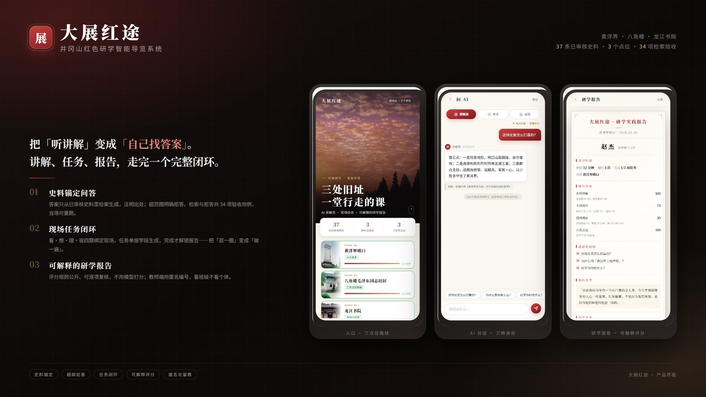

<div align="center">

`3` 个点位　·　`37` 条已审核史料　·　`11` 张官方实拍　·　`34` 项检索验收 **全部通过**

</div>

---

## 这是什么

学生到革命旧址，通常是听一段讲解、拍张照片就走。研学旅行要求「有过程、有产出、可评价」，
可现场一位老师带四十个学生，一对一带不动。

**大展红途做三件事：**

| | 做什么 | 怎么做 |
|---|---|---|
| **问** | 扫点位二维码，AI 讲解员回答现场问题 | 答案只从审核过的史料里取，每句带出处；超纲就明说「这个问题超出了已审核史料的范围」 |
| **做** | 四道现场任务：看 · 想 · 理 · 说 | 题目绑定实物，必须抬头看工事、看建筑才能答 |
| **留** | 自动生成研学报告 | 评分逐项公开，教师端按班级看进度 |

**一个刻意的取舍：宁可拒答，也不让 AI 凭印象讲。**
红色历史讲错一句，比答不出来严重得多。所以检索不达标就拒答，模型没有机会编。

---

## 90 秒走完一遍

| 时间 | 操作 | 会看到 |
|---|---|---|
| 0–10s | 扫码进入「黄洋界哨口」 | 官方实景大图 + 点位背景介绍 |
| 10–35s | 问：这场仗是怎么打赢的？ | 回答正文 + **可点开的史料出处** |
| 35–45s | 再问：黄洋界的门票多少钱？ | **明确拒答**，说明只能依据审核史料 |
| 45–75s | 做四道现场任务 | 拍工事、答因果、排顺序、写自述 |
| 75–90s | 生成报告 → 切教师端 | 评分逐项公开，班级进度一览 |

---

## 界面

<table>
<tr>
<td align="center" width="33%">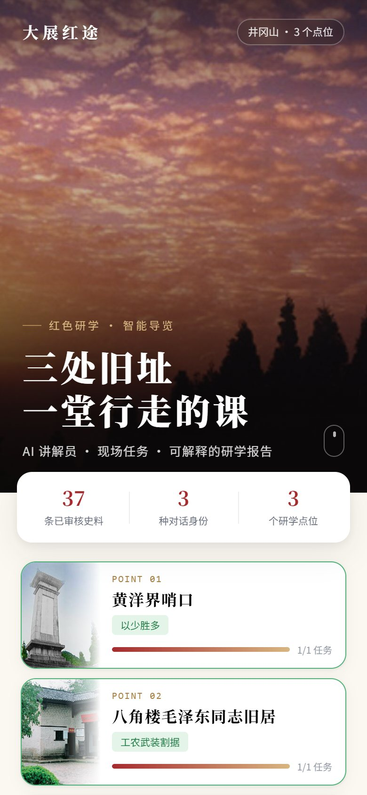<br><sub>入口 · 三点位路线</sub></td>
<td align="center" width="33%">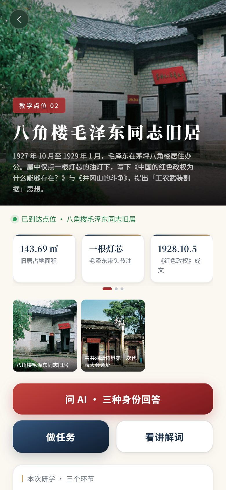<br><sub>点位详情 · 八角楼</sub></td>
<td align="center" width="33%">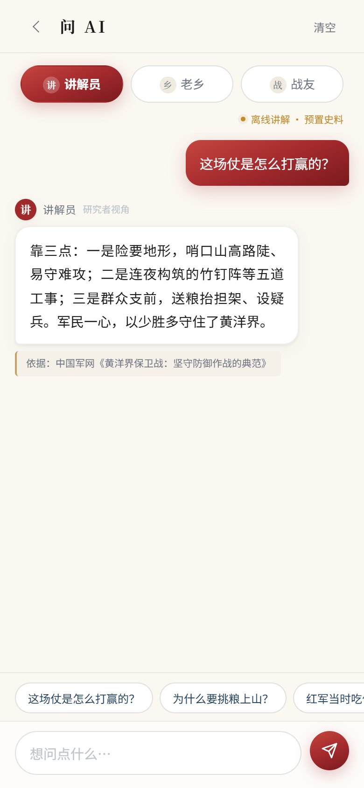<br><sub>AI 讲解 · 答案带出处</sub></td>
</tr>
<tr>
<td align="center">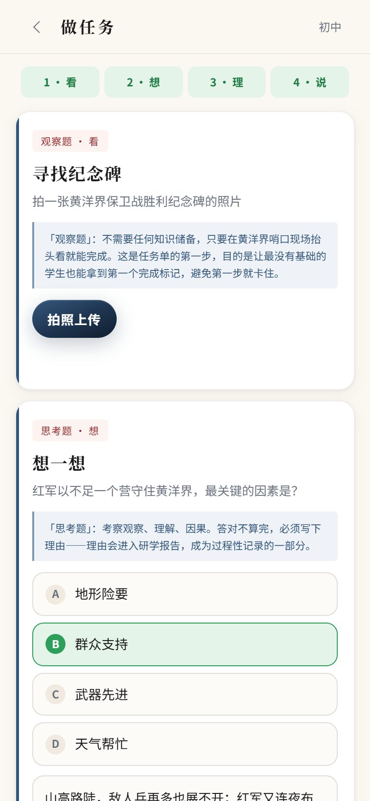<br><sub>现场任务 · 看想理说</sub></td>
<td align="center">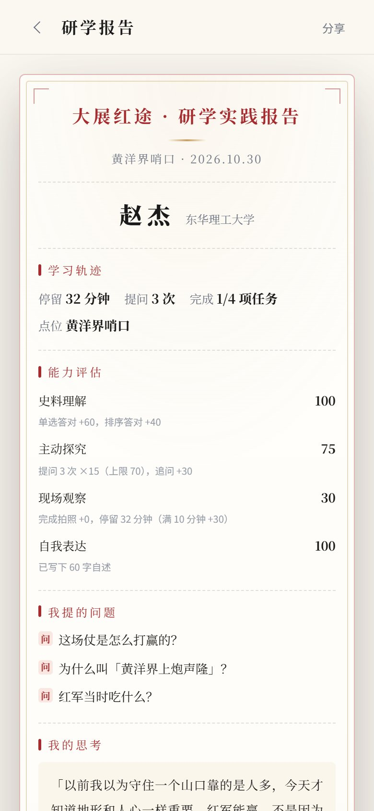<br><sub>研学报告 · 可解释评分</sub></td>
<td align="center">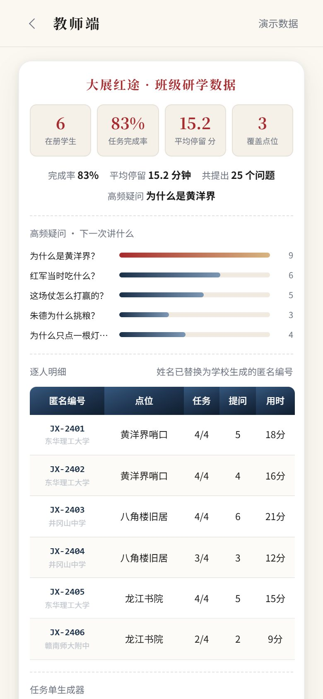<br><sub>教师端 · 匿名编号</sub></td>
</tr>
</table>

<details>
<summary><b>展开查看全部 11 张界面截图</b></summary>

<table>
<tr>
<td align="center" width="33%">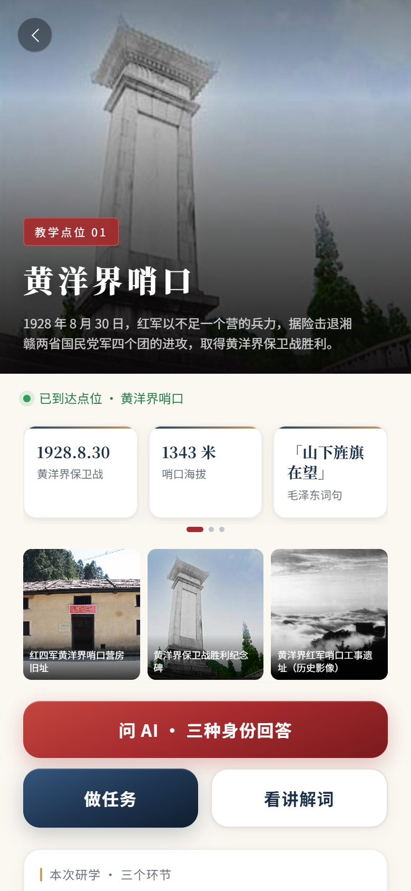<br><sub>点位 · 黄洋界哨口</sub></td>
<td align="center" width="33%">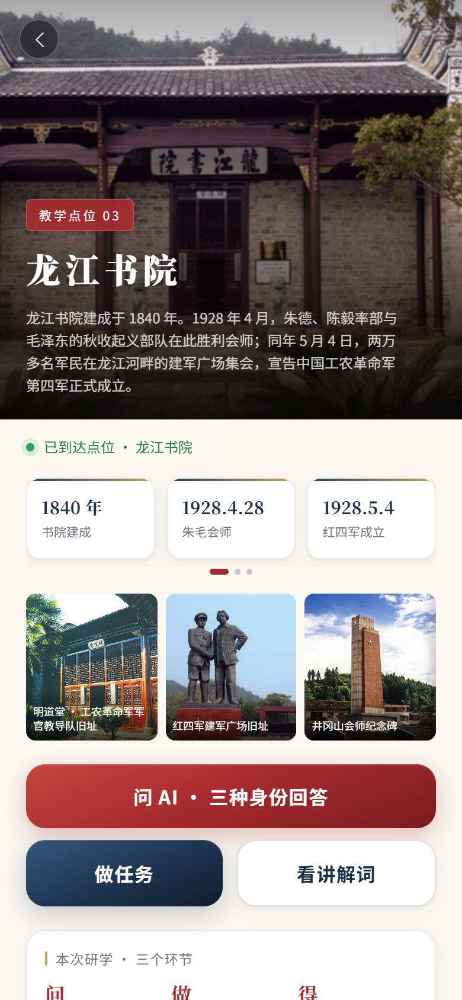<br><sub>点位 · 龙江书院</sub></td>
<td align="center" width="33%">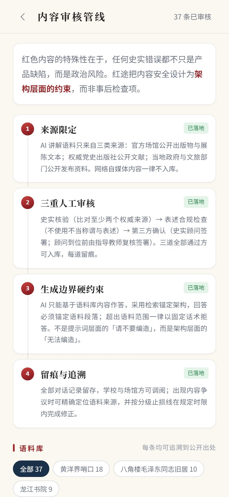<br><sub>内容审核管线</sub></td>
</tr>
<tr>
<td align="center">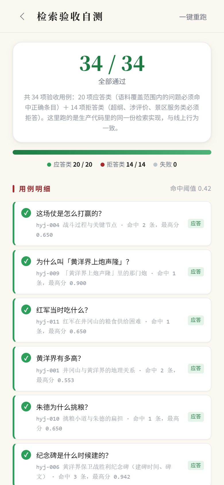<br><sub>检索自测台 · 34 项</sub></td>
<td align="center">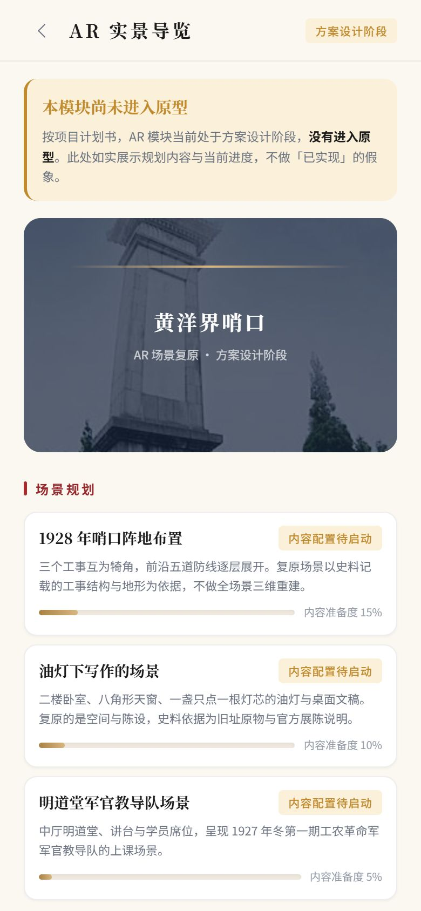<br><sub>AR 模块 · 方案设计</sub></td>
<td align="center"></td>
</tr>
</table>

</details>

---

## 核心能力

### 一、答案有据可查

37 条史料全部逐条标注官方出处，回答下方直接给出可点击的来源链接。
评委或老师可以当场点开核对——**这是我们和「让 AI 自由发挥」最大的区别。**

### 二、超纲就拒答

问题超出已审核史料范围时，不给「差不多」的答案，而是明确说明范围。
34 项检索验收用例里，有 14 项专门测「该拒的必须拒掉」。

### 三、评分可解释

报告不是给一个总分，而是拆成四维、逐项写明依据：

| 维度 | 依据 |
|---|---|
| 现场观察 | 是否完成拍摄任务 |
| 因果理解 | 选择题是否答对 |
| 逻辑排序 | 事件顺序是否正确 |
| 自我表达 | 自述字数（只判长度，不判对错） |

评语由模板拼接、引用学生自述原文生成，**不由模型自由发挥**。

### 四、断网也能演

研学现场在山上，网络和电力都不可靠。所以：

- 前端零构建、零依赖，**双击 `index.html` 就能完整跑**
- 后端不可用时自动降级到本地检索，回答照样带出处、照样拒答

---

## 技术架构

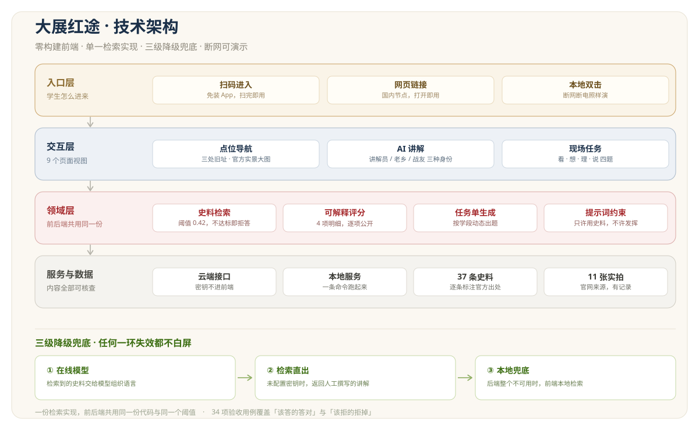

四层结构，核心取舍有三条：

**1. 检索实现只有一份。** 前端与后端 `require` 同一个 `retrieval.js`，同一个阈值（0.42）、同一套语料。
（早期版本前后端各写一遍、阈值不同，导致同一问题「离线能答、在线拒答」，这个坑已经填掉。）

**2. 密钥不进前端。** 模型调用全部走服务端，浏览器拿不到 key。

**3. 三级降级。** 在线模型 → 检索直出 → 本地兜底，任何一环挂掉都不白屏。

---

## 版本历程

| 版本 | 日期 | 内容 |
|---|---|---|
| **v2.0.1** | 10-30 | 交付前审查修复 6 处：路由参数错位、初中生缺「说」题、静态服务可越权读 `.env`、上传照片一闪消失等。**当前推荐版本** |
| v2.0.0 | 10-27 | 三点位全量重构。9 视图 · 37 条史料 · 34 项验收用例 · 可解释评分 |
| v1.0.0 | 10-27 | 黄洋界单点位原型。6 视图 · 18 条史料。**保留作现场兜底** |

两个版本代码都在仓库里，端口不同（v1: 8123 / v2: 8130），互不干扰。
v1 是「能跑就行」的第一版，v2 是重构后的完整版——**留痕的原因是可追溯，不是收藏。**

---

## 快速开始

### 方式一：双击启动（推荐）

双击根目录的 **`启动演示.bat`**，浏览器会自动打开 `http://127.0.0.1:8130`。

需要本机装有 [Node.js](https://nodejs.org)。未配置模型密钥也能完整演示。

### 方式二：命令行

```bash
cd v2
node server.js          # http://127.0.0.1:8130
```

### 方式三：完全离线

直接双击 `v2/index.html`。没有后端、没有网络也能跑完整流程。

### 变成一个网址给别人看

```bash
python tools/build_deploy.py     # 生成 dist.zip（3.2MB）
```

把 `dist.zip` 拖到 [腾讯云 EdgeOne Pages](https://console.cloud.tencent.com/edgeone/pages) 即可上线，
免备案、国内节点。详细步骤见 [部署上线说明](docs/部署上线说明.md)。

> 部署产物是纯静态的，`v2/` 下 15MB 的截图与 PPT 素材不会打进去——
> 那是自己用的材料，访客不需要。

---

## 检索验收

```bash
cd v2 && node _test.js              # 34 项：20 应答 + 14 拒答
curl http://127.0.0.1:8130/api/selftest   # JSON 格式
```

界面里也能跑：首页 → **检索自测** → 一键重跑。
跑的是生产代码里的同一份实现，与线上行为一致。

**当前状态：34 / 34 通过。**

---

## 三个点位

| 点位 | 主题 | 语料 |
|---|---|---|
| 黄洋界哨口 | 以少胜多 | 18 条 |
| 八角楼毛泽东同志旧居 | 工农武装割据 | 10 条 |
| 龙江书院 | 井冈山会师 | 9 条 |

---

## 文档

| 文档 | 内容 |
|---|---|
| [开发过程记录](docs/开发过程记录.md) | 版本演进、每次修了什么、为什么 |
| [能力边界与扩展方案](docs/能力边界与扩展方案.md) | 检索能力实测数据、三条扩展路径、成本测算 |
| [数据库与小程序决策建议](docs/数据库与小程序决策建议.md) | 现阶段为何不接数据库、迁小程序的技术与资质门槛 |
| [部署上线说明](docs/部署上线说明.md) | 三种上线方案的步骤与对比 |
| [启动说明](docs/启动说明.md) | 本地启动方式与常见问题 |
| [截图与 PPT 用法](docs/截图与PPT用法.md) | 截图和素材怎么用到 PPT |
| [Demo 开发需求书](docs/大展红途_Demo开发需求书.md) | 立项时的功能清单与验收口径 |
| [扫码上线注意事项](materials/扫码打不开-原因与三种可用方案.md) | 微信内置浏览器被托管平台拦截的实测记录 |
| [上传 GitHub 说明](docs/上传GitHub说明.md) | 推送步骤与常见失败排查 |

---

## 内容来源与合规

**图片来源**：`v2/assets/img/` 下 11 张照片全部来自**井冈山革命博物馆官网**（`jgsgmbwg.com`），
每张的原始 URL 与对应文章页记录在 `v2/assets/img/credits.json`。

选官网图是刻意的：版权最稳、答辩时来源最好讲，且与「内容可追溯」的产品主张一致。

**史料来源**：中国军网、央视网、共产党员网、人民网、井冈山革命博物馆官网，逐条标注出处。

**未成年人保护**：

- 教师端使用学校生成的**匿名编号**，不出现学生真实姓名
- 研学评语由模板拼接，不由模型生成
- 照片只在本机处理，不上传

**诚实标注**：AR 模块如实标注「方案设计阶段、尚未进入原型」，不做假演示。
这是一个讲「内容可核查」的项目，在演示里造假是自相矛盾。

---

<div align="center">
<sub>大展红途 · 2026 东华理工大学创新创业基本技能大赛</sub>
</div>
